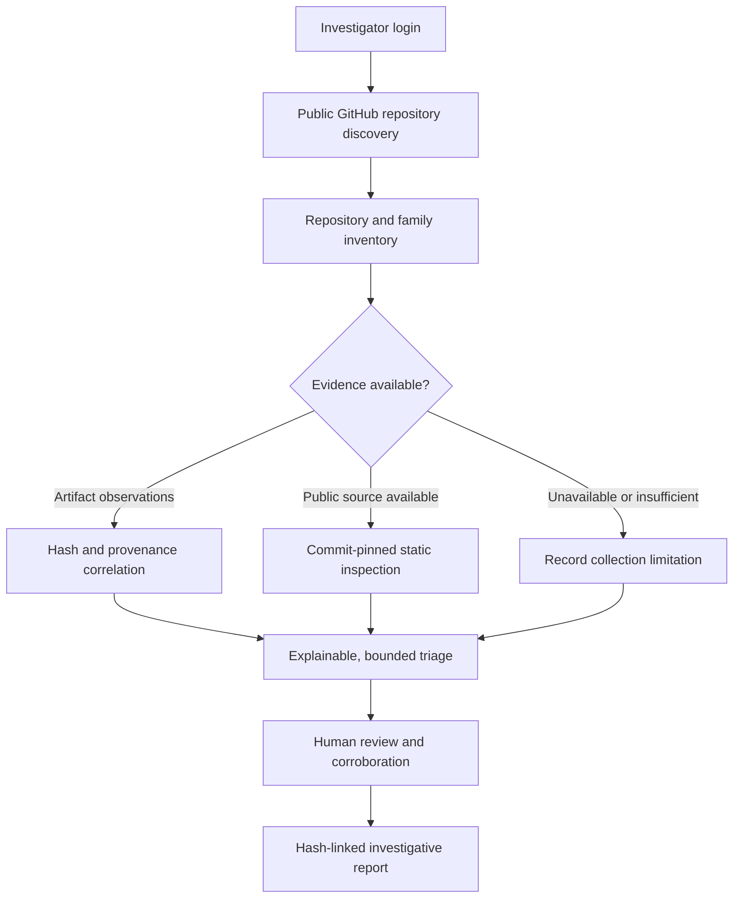

# SCAMGITBUSTER

### GitHub Threat Infrastructure Discovery & Evidence-Aware Repository Triage

**Discover public leads. Preserve provenance. Explain the limits of the evidence.**

**October 2026 · Investigative Technology Preview · Active Development**

---

## Overview

SCAMGITBUSTER is a privately developed, investigator-oriented platform for locating public GitHub repositories that may be relevant to cyber-enabled fraud investigations, correlating available technical evidence, and preparing reviewable investigative assessments.

It combines public-repository discovery, investigative-family workspaces, repository and artifact correlations, rule-based triage, limited commit-pinned source inspection, and evidence-linked reporting in a single authorized workflow.

**A repository search match is a lead, not a finding of wrongdoing.** SCAMGITBUSTER does not automatically establish that any repository, owner, or organization is involved in a scam.

## Why this project exists

Fraud investigations often begin with fragmented public signals: impersonation-themed repositories, deceptive application-delivery pages, downloadable packages, cloned branding, and references to infrastructure that may change or disappear.

Ordinary GitHub search can discover candidates, but an investigator must still address four questions:

1. **What was observed?** Which public repository and which immutable source or artifact observation?
2. **When and where?** What was the collection context, scope, and timestamp?
3. **What does the evidence support?** Is there a technical signal, an independently established artifact match, or only a suggestive name?
4. **What remains unknown?** Was source content unavailable, inspection partial, or a repository no longer accessible?

SCAMGITBUSTER is designed to help maintain this distinction throughout discovery, review and reporting.

## Demonstrated capabilities

| Area | Current capability | Status |
|---|---|---|
| Public GitHub discovery | Investigator-supplied keywords, repository metadata and hunt provenance | Operational |
| Scam-family workspace | Group relevant searches and inspect repository/owner relationships | Operational |
| Controlled access | Authenticated operator sessions, server-held integration credentials, protected actions | Operational |
| Artifact-aware triage | Match preserved observations and SHA-256-linked artifact decisions against repository candidates | Operational; requires context |
| Explainable rules | Prioritize evidence with recorded rule rationale and coverage limitations | Operational; triage only |
| Investigative reports | Repository-by-repository assessments, private JSON evidence snapshots with SHA-256, print-ready reports | Operational |
| Commit-pinned source inspection | Bounded public-code retrieval and static indicator analysis | **Experimental / incomplete coverage** |
| Unavailable-repository handling | Record failed retrievals and retain prior observations as separate evidence | Experimental |
| Malware execution / automatic attribution | Performed through TRACEGRID Sandbox Enviorenment | Restricted Enviorenment Success |

The source-inspection engine has demonstrated verification of an individual pinned source file in a controlled investigation. Later evidence-first scheduling trials have also returned **zero verified repositories despite multiple attempts**. Retrieval failures, incomplete coverage and false-negative risks are acknowledged development limitations, not concealed success conditions.

## Investigative workflow

## How to read an assessment

SCAMGITBUSTER distinguishes technical priority from confirmed wrongdoing.

- **High-risk artifact match** means preserved evidence correlates with a previously assessed artifact; it does not independently prove the repository's intent.
- **Suspicious indicators** means observed signals warrant review; isolated filenames or permissions are weak indicators.
- **Insufficient evidence** means available material does not support a defensible behavior-level conclusion.
- **No adverse indicators observed** (legacy triage wording) is not a benign certification. The ongoing ruleset correction restricts this label when coverage is metadata-only or superficial.
- **Currently unavailable** describes an unsuccessful retrieval, not confirmed deletion, guilt or disappearance.

A numeric prioritization score, where shown, is **not a probability of fraud**.

## Evidence principles

**DISCOVERY ≠ ATTRIBUTION. STATIC INDICATOR ≠ RUNTIME BEHAVIOR. NOT FOUND ≠ BENIGN.**

The platform's intended evidence lifecycle is:

**Observation → Context → Preservation → Hash → Correlation → Qualified Assessment → Human Review → Report**

See [Evidence Doctrine](docs/EVIDENCE_DOCTRINE.md) for coverage, uncertainty and evidentiary boundaries.

## Platform architecture

- **Investigator interface:** authenticated dashboard, hunts, investigative families, assessment and reporting controls.
- **Application services:** hunt orchestration, access controls and repository inventory.
- **Evidence services:** preserved metadata, source/artifact associations, explicit collection statuses, SHA-256 and report snapshots.
- **Intelligence services:** interpretable static rules, prioritization and limited pinned-source inspection.
- **Private operations:** credentials, storage, forensic records and server-side orchestration remain unpublished.

See [Architecture](docs/ARCHITECTURE.md).

## Current release status

This is a **public documentation preview of a privately operated investigative platform**, not a downloadable forensic application, an open-source backend, or a validated automated fraud detector.

Core discovery, login, family workspaces and reporting have been demonstrated. Deep inspection and retrieval reliability remain in development. Findings must be reviewed by a trained investigator and independently corroborated before evidentiary or legal use.

See [Release Notes](docs/RELEASE_NOTES.md) and [Roadmap](docs/ROADMAP.md).

## Public materials and access

This repository intentionally contains **documentation and synthetic examples only**. It does not include production code, access credentials, investigative records, live case reports, private endpoints, or operational infrastructure details.

The application is **not offered here for public self-service access**. Absence of a source-code license means no permission to copy or distribute the private implementation is granted.

## Intended audience

Law-enforcement investigators, digital forensics practitioners, incident responders, OSINT researchers and cybercrime-capacity-building audiences.

SCAMGITBUSTER is an independent technical initiative. This documentation does **not** imply official approval, procurement, endorsement or operation by any government agency.

## Project stewardship

**Indranil Mondal (CyberIndranil)**  
Cybercrime Investigation · Cybersecurity Research · Investigator-focused Technology Development in National Interest

## Responsible reporting

Do not open public GitHub issues containing sensitive case material, personal data, private links, recovered tokens, potentially malicious payloads or exploitation instructions. See [Security & Disclosure](docs/SECURITY.md).
