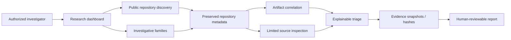

# SCAMGITBUSTER — Public Architecture

This is a **conceptual security-safe view**, not a deployment diagram or inventory of private APIs, infrastructure, credentials or code.

## Logical components

## Trust boundaries

- Authentication gates access to investigation functions.
- External provider credentials and the internal control secret remain server-side; the browser does not need them to initiate authorized searches.
- Public repository data are treated as untrusted inputs.
- Collected code is inspected statically and is **not executed** by the published workflow.
- Evidence hashes attest to preserved byte content; they do not prove a source is true or a suspect guilty.
- Collection limits and partial coverage are represented rather than silently ignored.

## Current integration status

Source inspection is a bounded and experimental feature. The presence of a verified pinned file does not imply that all repository source files, dependencies, binaries or runtime behavior have been assessed. Previously observed repositories can subsequently become inaccessible through a provider API; this is handled as a separate availability observation.

No operational topology is published in this repository.
